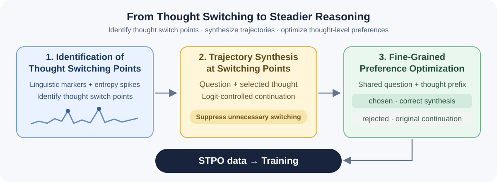

<h1 align="center">🧠 SteadyThought: Mitigating LLM Under-Thinking<br>via Thought-Level Preference Optimization</h1>

<p align="center"><em>Reducing unnecessary thought switching with thought-level preference optimization.</em></p>

<p align="center">
  
</p>

<p align="center">
  
  <a href="https://github.com/MIRALab-USTC/SteadyThought"></a>
</p>

<p align="center"><a href="README.zh-CN.md">简体中文</a></p>

---

## 📚 Overview

**SteadyThought** mitigates under-thinking through three stages: **Identification of Thought Switching Points**, **Trajectory Synthesis at Switching Points**, and **Fine-Grained Preference Optimization**. By detecting thought switch points with linguistic and entropy signals, synthesizing persistent continuations through logit control, and learning preferences under a shared question-thought context, it encourages commitment to promising reasoning directions while preserving the flexibility to explore alternatives.

## Installation

Run commands from the repository root:

```bash
conda create -n steadythought python=3.10 -y
conda activate steadythought
python -m pip install -r requirements.txt
```

## Construct STPO data

Edit the model path, dataset path and GPU IDs in `scripts/01_*.sh`–`03_*.sh` before running. Keep model and dataset settings consistent. Defaults use **DeepSeek-R1-Distill-Qwen-1.5B** and **Omni-MATH levels 2/3/7**.

```bash
# 1. Identification of Thought Switching Points.
bash scripts/01_identify_thoughts.sh

# 2. Trajectory Synthesis at Switching Points.
bash scripts/02_synthesize_trajectories.sh

# 3. Prepare pairs for Fine-Grained Preference Optimization.
bash scripts/03_build_stpo_dataset.sh
```

Or run all stages with `bash scripts/run_all.sh`. 

Final output: `outputs/<model>/<dataset>/<model>-<dataset>-stpo.jsonl`.

## Training

The output can be used directly as an Alpaca-format preference dataset in [LLaMA-Factory](https://github.com/hiyouga/LLaMA-Factory), without data conversion. Following its [dataset guide](https://github.com/hiyouga/LLaMA-Factory/blob/main/data/README.md#preference-dataset), register the file as `stpo` in `dataset_info.json`, set `ranking: true`, and map `prompt` to `instruction`, `chosen` to `chosen`, and `rejected` to `rejected`.

Install LLaMA-Factory separately and add these key settings to your complete training configuration ([training arguments](https://llamafactory.readthedocs.io/en/latest/advanced/arguments.html#rlhf)):

```yaml
stage: dpo
pref_loss: simpo
dataset: stpo
template: empty
cutoff_len: 6144
```

Use `template: empty` because `instruction` already contains the formatted prompt and thought prefix; `chosen` and `rejected` are continuations. Do not wrap the prefix in another chat template. The scripts above construct data only; training runs in LLaMA-Factory.
